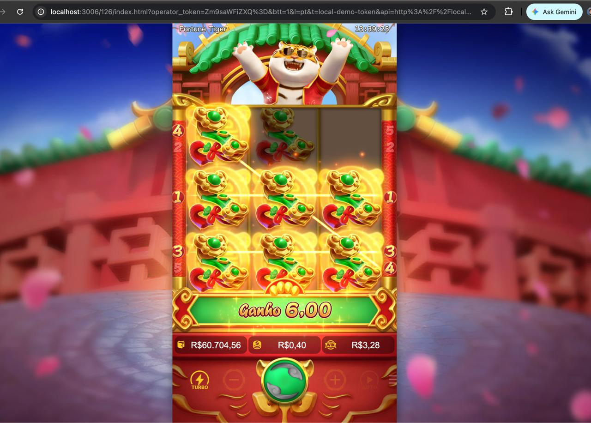

# PGSoft Node API

An unofficial, open-source TypeScript reimplementation of the backend used by bundled PG Soft game clients. It provides a game catalog, session and launch URLs, game information, and spin endpoints. The local setup includes a simulated wallet and uses fictional balances.



## Run locally

You need **Node.js 20.11.0**, **Yarn Classic 1.22.4**, and **Docker with Compose v2**. Docker runs **MySQL 8.0.36**. The API and wallet simulator run on the host.

From the project directory, use the pinned Node version and install dependencies from `yarn.lock`:

```sh
nvm install
nvm use
PUPPETEER_SKIP_DOWNLOAD=true corepack yarn install --frozen-lockfile
```

With Docker running, create a local `.env`, start MySQL, build the API, and seed the database:

```sh
test -f .env || cp .env.example .env
docker compose up -d --wait mysql
npm run build
npm run db:seed
npm run local
```

`npm run local:setup` is a shortcut for starting MySQL, building the API, and seeding the database. Run `npm run local` afterward and leave the terminal open.

| Service | Local address |
| --- | --- |
| API and games | `http://localhost:3006` |
| Wallet simulator | `http://127.0.0.1:3007` |
| MySQL | `127.0.0.1:3306` |

If MySQL port `3306` is already in use, set a free `DB_PORT` in `.env` before starting the container. Both Docker Compose and the API read that setting.

## Open a game

- [Check API health](http://localhost:3006/status)
- [Open the demo catalog](http://localhost:3006/api/v1/games/demo)
- [Play the Fortune Tiger demo](http://localhost:3006/126/index.html?operator_token=Zm9saWFiZXQ%3D&btt=1&l=pt&t=local-demo-token&api=http%3A%2F%2Flocalhost%3A3006&localDemo=1)

In the demo catalog, open a game's `launch_url`. If the client shows a compatibility screen, select **Avançar para o jogo** (Continue to Game), then **Começar** (Start). The local demo link uses the client's existing Ignore action to dismiss the external verification prompt.

The catalog includes 30 titles. It currently provides launch URLs for 27. **Wings of Iguazu** lacks its game page, **Wild Bounty Showdown** lacks required loading files, and **Rainbow Jackpots Megaways** relies on an external service and a separate session flow.

## Call the API

`GET /api/v1/games` returns each game's ID, name, provider, availability, and `launch_url`. Authenticate with the session token, found in the `t` query parameter of the URL returned by `POST /api/v1/game_launch`. Listing games leaves balances unchanged.

```sh
curl -fsS http://localhost:3006/api/v1/games \
  -H 'Authorization: Bearer local-demo-token'
```

The separate `GET /api/v1/games/demo` endpoint uses the fictional demo player and is available on loopback in `AMBIENTE=DEV`.

## Local database and checks

The [MySQL schema](docker/mysql/init/001-schema.sql) is inferred from the API's queries. The [seed script](scripts/seed-local.cjs) creates a demo agent, a player with a starting balance of 1,000 fictional BRL, and initial game states using the fixtures in the project. Running the seed again preserves existing balances and completed rounds. Demo credentials and database defaults are defined in [`.env.example`](.env.example) and the seed script. Redis is unnecessary for the local flows covered by the smoke test.

With the API and wallet simulator running, run the checks from a second terminal:

```sh
npm run typecheck
npm run test:smoke
```

The smoke test checks the catalog and its launch URLs, session verification, all 29 active `GameInfo` endpoints, and spins for Fortune Tiger, Fortune Ox, Fortune Rabbit, and Treasures of Aztec.

To stop the API and simulator, press Ctrl+C in their terminal. To stop the database and keep its data:

```sh
docker compose stop mysql
```

## License and attribution

The backend package declares the MIT license in [`package.json`](package.json). PG Soft game clients, names, artwork, and other third-party assets are separate from that license and belong to their respective rights holders. This project is unaffiliated with PG Soft.
